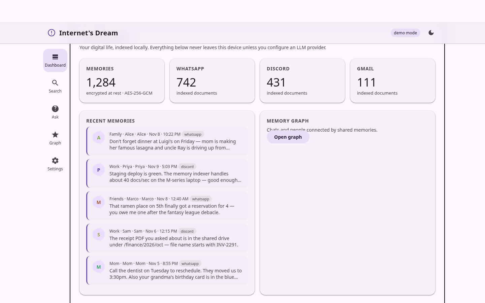
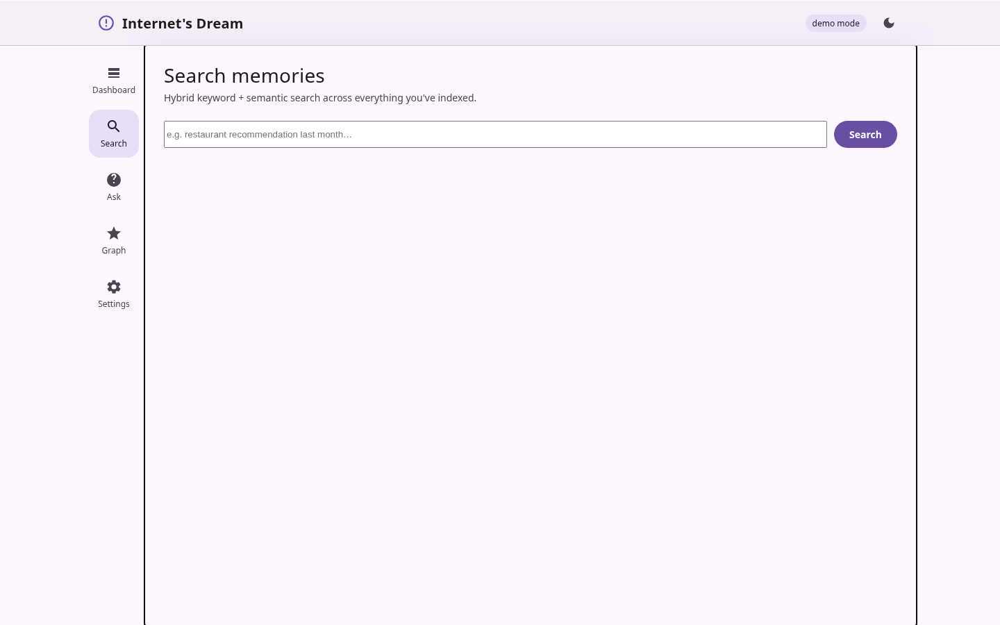
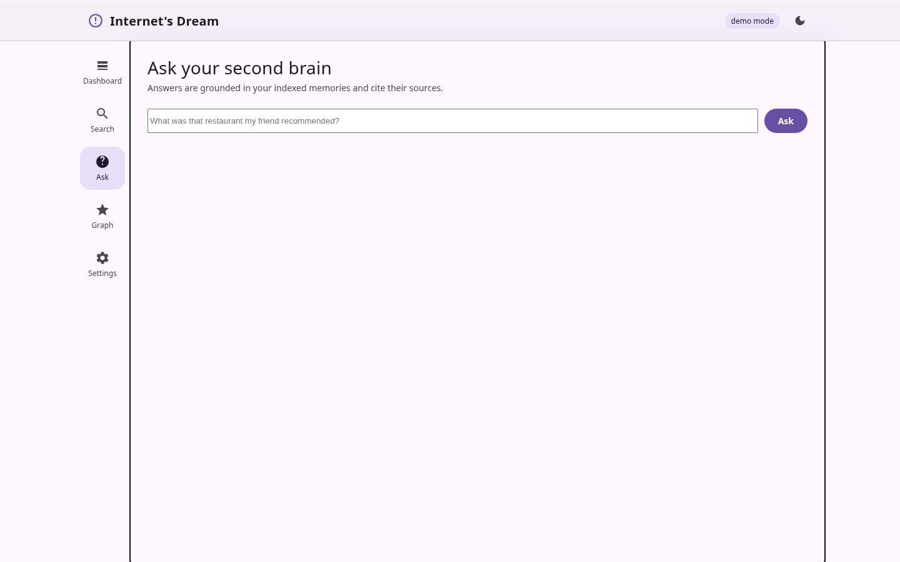
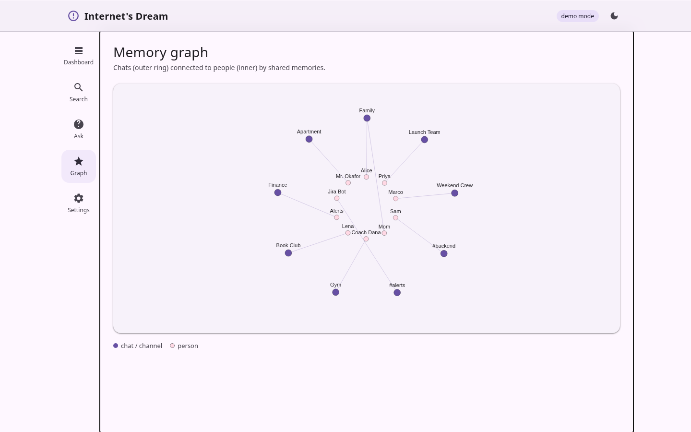
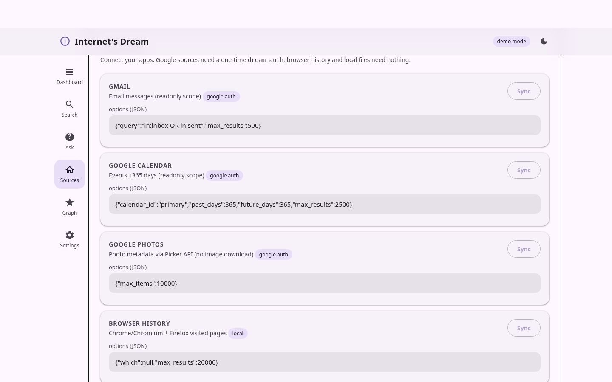
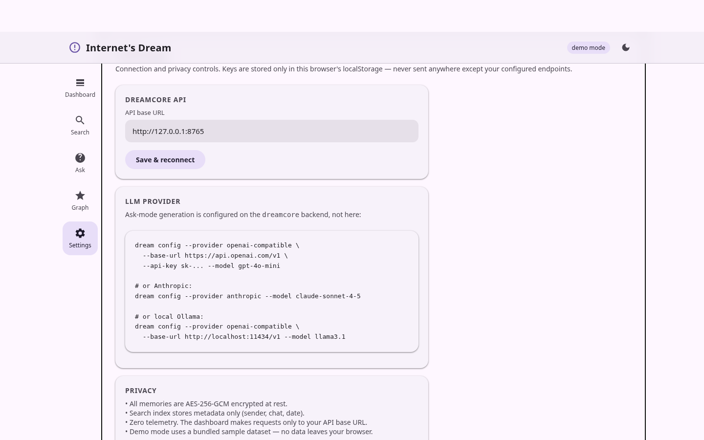

<div align="center">

# Internet's Dream

**Universal Contextual Memory — a private, locally-encrypted personal second brain. Index your chats, mail, and calendar metadata, then ask "what was that restaurant my friend recommended last month?"**

[](https://github.com/Anonyoumss/internet-dream/actions/workflows/ci.yml)
[](https://github.com/Anonyoumss/internet-dream/actions/workflows/pages.yml)
[](https://github.com/Anonyoumss/internet-dream/actions/workflows/android.yml)
[](https://github.com/Anonyoumss/internet-dream/actions/workflows/macos.yml)
[](https://github.com/Anonyoumss/internet-dream/actions/workflows/linux.yml)
[](core/pyproject.toml)
[](web-dashboard/styles.css)
[](desktop-mac)
[](desktop-linux)
[](UNLICENSE)

**[Live dashboard](https://anonyoumss.github.io/internet-dream/)** · **[Artifacts (APK · DMG · tarball)](https://github.com/Anonyoumss/internet-dream/actions)** · **[Report a bug](https://github.com/Anonyoumss/internet-dream/issues/new)**

</div>

---

We store our lives across fifty apps — notes, chats, bookmarks, screenshots,
receipts — and finding the one thing you saw three weeks ago is nearly
impossible. Internet's Dream is a **private, locally-encrypted memory core**
that indexes what you choose to share and answers questions across all of it.

```
WhatsApp _chat.txt ─┐
DiscordChatExporter ─┼─► dreamcore ─► AES-256-GCM store + FTS5 + vectors
Gmail/Cal/Photos ───┘      │                │
                     LLM gateway      ┌─────┼──────────┐
                     (OpenAI-compat,  ▼     ▼          ▼
                      Anthropic,     Web   macOS     Android
                      Ollama…)      M3     Liquid    M3
                                   Pages   Glass     Compose
                                              │
                                           Qt/PyQt6
                                            Linux
```

## Contents

- [Screenshots](#screenshots)
- [Features (what actually exists today)](#features-what-actually-exists-today)
- [How it works](#how-it-works)
- [Downloads](#downloads)
- [Quickstart](#quickstart)
- [Ingesting your data](#ingesting-your-data)
- [LLM providers](#llm-providers)
- [Tech stack](#tech-stack)
- [Repository layout](#repository-layout)
- [Deploying](#deploying)
- [FAQ](#faq)
- [Honest limits](#honest-limits)
- [Roadmap](#roadmap)
- [Agent orchestration](#agent-orchestration)
- [Contributing](#contributing)

---

## Screenshots

The web dashboard ships in **demo mode** — a bundled sample dataset — so the
GitHub Pages site works with zero backend. Live mode connects to `dreamcore serve`.

| Dashboard | Search | Ask |
|---|---|---|
|  |  |  |

| Memory graph | Sources | Settings |
|---|---|---|
|  |  |  |

## Features (what actually exists today)

- **Encrypted local store** — every document payload is AES-256-GCM encrypted
  at rest in SQLite; keys live in `~/.internet-dream/` with `0600` perms.
  PBKDF2-HMAC-SHA256 (600k iterations) when you supply a passphrase.
- **Hybrid search** — FTS5 keyword search fused (reciprocal rank) with
  vector similarity. Offline default embedder is a deterministic hashing
  embedder — zero dependencies, works fully offline.
- **Chat ingestion** — WhatsApp "Export chat" `_chat.txt` (multi-locale date
  formats, continuation lines, system-message filtering) and
  DiscordChatExporter JSON.
- **Ask mode** — retrieve-then-generate through a provider-agnostic LLM
  gateway: OpenAI-compatible endpoints (OpenAI, Gemini compat, Ollama,
  llama.cpp) and Anthropic Messages API. Graceful degradation to raw
  matches when no key is configured.
- **Source sync framework** — one pipeline ingests from every connector:
  - **Gmail** — message metadata + body text (`gmail.readonly`)
  - **Google Calendar** — events ±365 days (`calendar.readonly`)
  - **Google Drive** — file metadata + text-file contents (`drive.readonly`)
  - **Google Photos** — photo metadata via Picker API, no image download
  - **YouTube history** — watch/search history from Google Takeout
  - **Telegram** — bot-visible messages; interactive bot can read, answer,
    and send files (`dream telegram-bot`)
  - **Browser history** — Chrome/Chromium + Firefox visited pages (local DB)
  - **Local files** — text-readable files in any directory, chunked
  - **Chat exports** — WhatsApp `_chat.txt` + DiscordChatExporter JSON
  One `dream auth` (CLI) **or** backend `GET /auth/google/start` (web)
  OAuth flow covers all Google sources — the token is shared by the
  dashboard, Android app, extension, and Telegram bot. Browser/files/
  Telegram need no Google auth at all.
- **Discord (live)** — `dream sync discord` exports messages from all your
  servers via the REST API using a token *you* save to
  `~/.internet-dream/discord_token.txt` (GET requests only, nothing sent).
  DiscordChatExporter JSON also works via `dream ingest`.
- **WhatsApp (live)** — `whatsapp-bridge/` links your real account via QR
  (Baileys/WhatsApp Web multi-device) and indexes every incoming message —
  read-only, never sends anything.
- **REST API** — `/ingest`, `/ingest-upload`, `/ingest-text`, `/chat`
  (agent with tools), `/sync`, `/sources`, `/search`,
  `/ask`, `/stats`, `/graph`, `/documents/{id}`, `/config`, `/health`,
  `/auth/google/start|callback`, `/auth/status`.
- **Agent chat** — `POST /chat` runs an LLM tool-calling loop: it can
  `search_memory`, `remember`, `sync_source`, `get_stats`, `list_sources`.
  The dashboard **Chat** page is a real conversation with visible tool steps.
- **Setup wizard** — dashboard `#/setup`: paste API key → connect Google →
  pick sources → chat. Five steps to a fully indexed second brain.
- **Web dashboard** — Material 3 design system (self-contained CSS, dark
  mode, PWA manifest), hash-routed views: Dashboard, Search, Chat (agent),
  Setup wizard, Sources (with export upload), Memory graph, Settings.
  Demo mode for GitHub Pages.
- **macOS client** — SwiftUI with Liquid Glass materials on macOS 26+
  (ultra-thin-material fallback), packaged as an unsigned `.dmg` by CI.
- **Android app** — Jetpack Compose + Material 3, debug APK built by CI.
- **Linux client** — PyQt6 desktop app with system tray, dark Material-ish
  theme; ships as a tarball from CI.
- **Agent orchestrator** — `agents/orchestrator.py`: planner → coder →
  reviewer loop over `goal.md` / `design.md` / `handoff.md`, with an
  allow-listed command set and pytest-based review gate.
- **No telemetry. Nothing phones home.**

## How it works

Every client — web dashboard, macOS app, Android app, Linux client,
browser extension, Telegram bot/userbot — is a thin shell over the same
`dreamcore serve` API, so **every feature is available on every platform**
automatically. There is exactly one backend (`dream serve`), one token
store, one encrypted database.

Ingestion parses an export into `Document`s → text is embedded → payloads
are encrypted and stored; FTS5 indexes metadata only (sender/chat/date/title —
a documented trade-off). `/ask` retrieves the top-k memories, injects them
into a grounded prompt, and streams back a cited answer.

## Downloads

| Platform | Artifact | Where |
|---|---|---|
| Web | Live dashboard | [GitHub Pages](https://anonyoumss.github.io/internet-dream/) |
| macOS | `Internet's Dream.dmg` (unsigned) | [Actions → macOS DMG](https://github.com/Anonyoumss/internet-dream/actions/workflows/macos.yml) |
| Android | `app-debug.apk` | [Actions → Android APK](https://github.com/Anonyoumss/internet-dream/actions/workflows/android.yml) |
| Linux | `internet-dream-linux-x86_64.tar.gz` | [Actions → Linux package](https://github.com/Anonyoumss/internet-dream/actions/workflows/linux.yml) |
| Browser ext. | `internet-dream-extension.zip` (MV3) | [Actions → Browser extension](https://github.com/Anonyoumss/internet-dream/actions/workflows/extension.yml) |

Unsigned macOS builds trigger Gatekeeper — right-click → Open on first launch.
Android debug APKs install via `adb install` or direct transfer.

## Browser extension

An MV3 extension (`extension/`) turns any page into a memory:

- **Save this page** — title, URL, and optional selection → `/ingest-text`
- **Right-click → Save page / Save selection** — context-menu capture
- **Popup search** — query your memory without leaving the tab
- API base is configurable in the popup (default `http://127.0.0.1:8765`)

Install: download the zip from Actions, unzip, then
`chrome://extensions` → Developer mode → *Load unpacked*. Works in
Firefox via `about:debugging` → *Load Temporary Add-on*.

## Quickstart

```bash
git clone https://github.com/Anonyoumss/internet-dream.git
cd internet-dream
python3 -m venv .venv && .venv/bin/pip install -e core

# optional: set an LLM provider
.venv/bin/dream config --provider openai-compatible \
  --base-url https://api.openai.com/v1 --api-key sk-... --model gpt-4o-mini

# ingest a WhatsApp or DiscordChatExporter file
.venv/bin/dream ingest ~/Downloads/_chat.txt --chat-name "Family"

# serve the API the dashboards talk to
.venv/bin/dream serve            # http://127.0.0.1:8765
```

Then open the [web dashboard](https://anonyoumss.github.io/internet-dream/)
and it auto-detects the local backend (set the API base in Settings if needed).

## Ingesting your data

Chat exports:

- **WhatsApp**: chat → ⋯ → More → Export chat → *Without media* produces
  `_chat.txt`. `dream ingest _chat.txt`.
- **Discord**: `dream sync discord` (live, read-only — token in
  `~/.internet-dream/discord_token.txt`), or DiscordChatExporter JSON →
  `dream ingest channel.json`.
- **WhatsApp live**: `cd whatsapp-bridge && npm install && ./run.sh` —
  scan the QR once (WhatsApp → Linked Devices), then every incoming
  message is indexed automatically. Never sends messages.
- **WhatsApp exports**: `dream sync whatsapp --opt path=~/Downloads` picks
  up any `_chat.txt` exports it finds, or upload one on the dashboard
  Sources page.
- **Anything else**: `dream ingest-text --title "..." --text "..."`.

Connected sources (`dream sync <source>`, or `POST /sync`):

```bash
dream sources                              # list sources + options

# one-time Google setup (Gmail + Calendar + Photos)
# 1. Google Cloud Console → OAuth client (Desktop app)
# 2. save it as ~/.internet-dream/client_secret.json
dream auth                                 # browser consent → token.json

dream sync gmail                           # emails (in:inbox OR in:sent)
dream sync gmail --opt "query=newer_than:30d" --opt max_results=2000
dream sync calendar                        # events ±1 year
dream sync photos                          # photo metadata (no downloads)
dream sync browser                         # Chrome/Firefox history
dream sync files --opt path=~/Documents    # index a folder of text files
dream sync whatsapp --opt path=~/Downloads # WhatsApp _chat.txt exports
dream sync discord                         # all servers (needs token file)
dream sync youtube --opt "path=.../watch-history.html"
dream sync telegram                        # recent bot updates
```

Google scopes requested: `gmail.readonly`, `calendar.readonly`,
`drive.readonly`, `youtube.readonly`, `photospicker.mediaitems.readonly`.
Client secret and token live in `~/.internet-dream/` with `0600` permissions.

### Google login — two ways, same token

**Backend web flow (easiest — one consent for everything):**

1. Create a Google Cloud OAuth client. For the web flow use type
   *Web application* and register the redirect URI
   `http://127.0.0.1:8765/auth/google/callback` (adjust host/port if your
   `dream serve` differs). Save it as `~/.internet-dream/client_secret.json`.
2. `dream serve`, then open `http://127.0.0.1:8765/auth/google/start` — or
   click **Connect Google account** in the dashboard Settings.
3. Done — the token at `~/.internet-dream/token.json` is shared by the
   dashboard, Android app, browser extension, and Telegram bot.

**CLI flow:** `dream auth` (installed-app loopback consent).

### YouTube history (Google Takeout)

YouTube doesn't expose watch history via API — export it:

1. [takeout.google.com](https://takeout.google.com) → *YouTube and YouTube
   Music* → *History* → export.
2. Unzip, find `watch-history.html` (and/or `search-history.html`).
3. `dream sync youtube --opt "path=~/Downloads/.../watch-history.html"`
   — or pass a list via the API/dashboard: `{"paths": [".../watch-history.html", ".../search-history.html"]}`.
   JSON activity exports work too (`path=file.json`).

### Telegram — bot *or* your real account

**Bot mode** (sees only chats it's in):

1. Message [@BotFather](https://t.me/BotFather) → `/newbot` → copy the token.
2. `dream config --telegram-token 123456:ABC...`
3. `dream telegram-bot` — commands below.

**Userbot mode** (Telethon — logs in as *you*, full account access):

1. Get `api_id` + `api_hash` at [my.telegram.org](https://my.telegram.org)
   → *API development tools*.
2. `dream config --tg-api-id 12345 --tg-api-hash abcdef`
3. `pip install -e 'core[telegram]'`
4. `dream tg-login` — phone → code → 2FA (session saved to
   `~/.internet-dream/telegram_user.session`)
5. `dream tg-sync` — index recent messages from **every dialog**
6. `dream tg-bot` — assistant in **Saved Messages**: same commands as the
   bot (`/ask /search /stats /remember /export /sync`), files you send
   there are downloaded to `~/.internet-dream/inbox/` and indexed, and
   `/export` sends memories back as files. `--chat <name>` watches a
   specific chat instead.

Bot commands (`dream telegram-bot`):

   | Command | Does |
   |---|---|
   | `/ask <question>` | LLM answer grounded in your memory |
   | `/search <query>` | hybrid search, top 5 |
   | `/stats` | corpus stats |
   | `/remember <text>` | save a note |
   | `/export <query>` | sends matching memories back **as a .md file** |
   | `/sync <source> [k=v]` | trigger any source sync |
   | *(any other text)* | saved as a memory |
   | *(send a document/photo)* | downloaded to `~/.internet-dream/inbox/` and indexed if text-readable |

   `dream sync telegram` also dumps recent `getUpdates` into the store.
   For full-account access use the Telethon userbot commands above.

## LLM providers

`dream config` writes `~/.internet-dream/config.json` (chmod 600):

| Provider | Flags |
|---|---|
| OpenAI | `--provider openai-compatible --base-url https://api.openai.com/v1 --model gpt-4o-mini` |
| Gemini | `--provider openai-compatible --base-url https://generativelanguage.googleapis.com/v1beta/openai --model gemini-2.0-flash` |
| Anthropic | `--provider anthropic --model claude-sonnet-4-5` |
| Ollama (local) | `--provider openai-compatible --base-url http://localhost:11434/v1 --model llama3.1` |

API keys can also come from `DREAM_LLM_API_KEY`. Embeddings default to the
offline hashing embedder; point `embed.base_url` at any OpenAI-compatible
`/embeddings` endpoint for true semantic vectors.

## Tech stack

- **Core**: Python 3.10+, SQLite + FTS5, AES-256-GCM (`cryptography`),
  FastAPI, httpx, provider-agnostic LLM gateway.
- **Web**: vanilla JS + self-contained Material 3 CSS, canvas graph, PWA.
- **Browser ext.**: Manifest V3, service worker, context menus, popup.
- **macOS**: SwiftUI, Liquid Glass (`glassEffect` on macOS 26+, material
  fallback), unsigned DMG via `hdiutil`.
- **Android**: Kotlin, Jetpack Compose, Material 3.
- **Linux**: PyQt6, Fusion style, system tray.

## Repository layout

```
core/               dreamcore package: store, crypto, embed, ingest, llm, api, cli
web-dashboard/      static Material 3 dashboard → GitHub Pages
desktop-mac/        SwiftUI Liquid Glass client
desktop-linux/      PyQt6 client
mobile-android/     Compose Material 3 app
extension/          MV3 browser extension (save page/selection/search)
agents/             planner/coder/reviewer orchestrator
tests/              pytest suite
scripts/            build-mac-dmg.sh
.github/workflows/  ci · pages · android · macos · linux
goal.md design.md handoff.md   agent state protocol
```

## Deploying

Push to `main` — CI runs tests, deploys `web-dashboard/` to GitHub Pages,
and builds the APK/DMG/tarball artifacts. Enable Pages once under
*Settings → Pages → Source: GitHub Actions* (the workflow also does this
via the `github-pages` environment).

## FAQ

**Does my data leave the device?** Only if you configure an LLM provider —
and then only the retrieved memory snippets in the ask prompt. Search,
storage, and embeddings (default) are 100% local.

**Is the search index encrypted?** Payloads are AES-256-GCM encrypted; the
FTS5 index holds plaintext metadata (sender, chat, date, title) needed for
lookup. Content is never indexed in plaintext.

**Why unsigned binaries?** CI has no Apple/Android signing certs. Artifacts
are debug/ad-hoc signed; sign them yourself for distribution.

## Honest limits

- Gmail/Calendar/Photos adapters **are implemented** (OAuth + readonly
  scopes); they activate once you run `dream auth` with a Google Cloud
  Desktop OAuth client. Browser-history and local-file sync work today
  with zero auth.
- The hashing embedder is keyword-ish; semantic quality improves a lot with
  an embeddings endpoint.
- Native clients are thin shells over the local API — they need
  `dream serve` running (or a reachable host).
- Android/macOS artifacts are CI-built but not yet device-verified end-to-end.
- The orchestrator is a guarded scaffold, not an autonomous agent.

## Roadmap

- Gmail/Calendar/Google Photos sync adapters
- Browser extension bridge for live page context
- On-device embeddings (nomic-embed / MLX)
- Signed release builds + auto-update
- Memory graph analytics (entities, timelines)

## Agent orchestration

`agents/orchestrator.py` implements the planner/coder/reviewer loop:

```bash
python3 agents/orchestrator.py --plan-only   # show pending steps
python3 agents/orchestrator.py               # run bounded loop
```

It reads unchecked items from `handoff.md`, executes allow-listed commands,
and gates completion on `pytest`. See `design.md` for the architecture and
`goal.md` for success criteria.

## Contributing

Issues and PRs welcome. Match the existing style, keep the no-telemetry
guarantee, and update `handoff.md` when you land a phase.

## License

No license — released to the public domain. See [UNLICENSE](UNLICENSE).
Do whatever you want with it.
